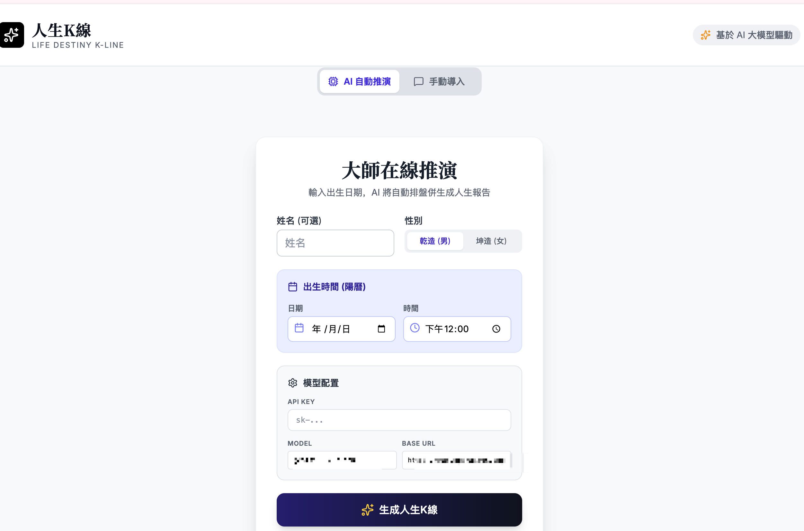
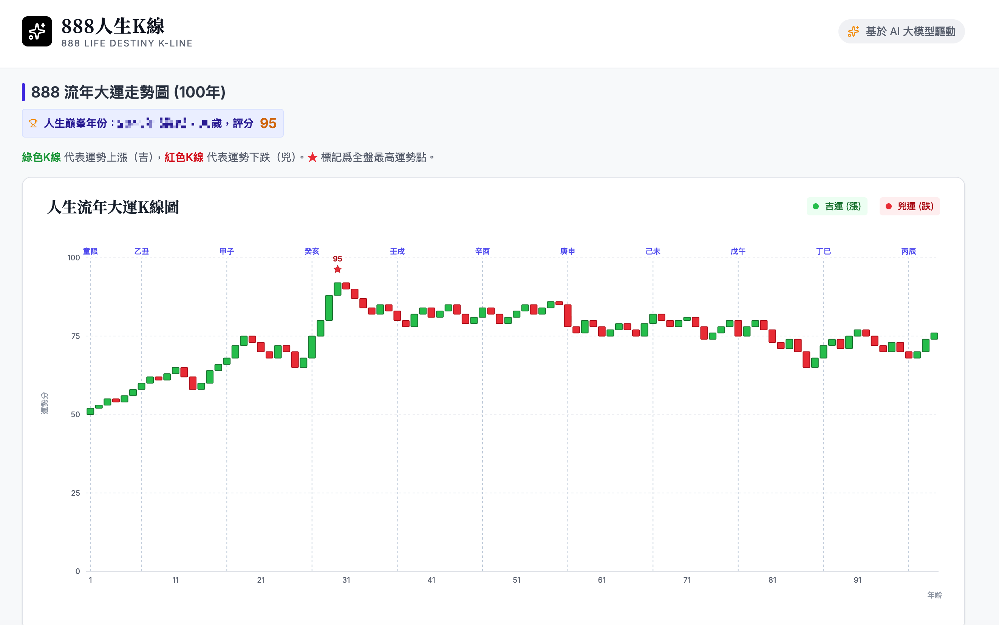

# 🔮 888 人生 K 線 (888 Life Destiny K-Line)

特別感謝原作者：[curionox/lifekline](https://github.com/curionox/lifekline.git)

> **基於 AI 大模型和傳統八字命理，將人生運勢以 K 線圖形式可視化展現。**

[](https://vercel.com/new/clone?repository-url=https://github.com/tbdavid2019/life-destiny-kline)

---

## ✨ 功能特點

1. **自動化八字計算**: 整合 `lunar-javascript`，只需輸入出生日期時間即可自動計算四柱與大運，無需手動排盤。
2. **可視化運勢**: 用股票 K 線圖展示 1-100 歲的人生運勢起伏，直觀呈現人生"牛市"與"熊市"。
3. **AI 深度批斷**: 支援直接調用大模型 API（如 Gemini, OpenAI），一鍵生成性格、事業、財富等報告。
4. **發展風水**: 提供方位建議、地理環境選擇及開運佈局。
5. **Web3 特供**: "幣圈交易運勢"板塊，包含暴富流年預測與交易風格建議。

---

## 📝 使用方法

1. **填寫出生信息** - 選擇姓名、性別、出生日期時間與出生地點（含天文真太陽時校正），系統會自動計算四柱八字與紫微雙盤資訊。
2. **選擇 AI 引擎**：
   - **免費預設 AI 引擎**（當站方於後端啟用時顯示）：無須填寫任何 API Key，直接點擊生成即可體驗。
   - **自備金鑰 (BYOK)**：選擇 Gemini、OpenAI、Claude、Groq、Grok、OpenRouter、AWS Bedrock 或自定義相容端點，填入您的 API Key 與模型名稱。
3. **一鍵生成** - 點擊「生成 888 人生 K 線與百年詳批」，等待 AI 分析後即可查看圖表與流年詳批報告。
4. **手動導入 (備選)** - 若不使用線上 AI 引擎，可切換至「手動導入」板塊，將外部 AI 產生的 JSON 數據貼回呈現。

---

## 🚀 一鍵部署

### Vercel 部署（推薦）

點擊下方按鈕一鍵部署到 Vercel：

[](https://vercel.com/new/clone?repository-url=https://github.com/tbdavid2019/life-destiny-kline)

### 本地運行

```bash
# 安裝依賴
npm install

# 啓動開發服務器
npm run dev

# 構建生產版本
npm run build
```

---

## ⚙️ 環境配置與使用說明 (支援免費代理與 BYOK 雙模式)

本專案同時支援 **BYOK (Bring Your Own Key)** 與可選的 **Vercel Serverless 免費 AI 代理**：

### 1. 免費 AI 引擎（Vercel Serverless 伺服器端環境變數）
透過 `api/free-llm.ts` 在伺服器端安全轉發請求，所有金鑰僅存於 Vercel 後台環境變數中，不會打包進前端靜態檔案或外洩給瀏覽器：

| 變數名稱 | 說明 | 範例值 |
| :--- | :--- | :--- |
| `FREE_LLM_ENABLED` | 免費模式總開關（設為 `false` 並 Redeploy 即可隨時關閉） | `true` |
| `FREE_LLM_API_KEY` | 上游 OpenAI 相容閘道之私密金鑰（**僅限伺服器端**） | `sk-...` |
| `FREE_LLM_BASE_URL` | 上游 OpenAI 相容端點基礎位址 | `https://llm.aiurl.tw/v1` |
| `FREE_LLM_MODEL` | 免費模式預設模型名稱 | `group/talk` |
| `FREE_LLM_ALLOWED_ORIGINS` | 允許呼叫的瀏覽器來源 CORS 白名單（可選，逗號分隔） | `https://life-destiny-kline.vercel.app,https://tbdavid2019.github.io` |

### 2. 前端建置環境變數 (選填，僅限公開參數)
- **重要安全提示**：`VITE_*` 變數會被打包進公開靜態資源中，**嚴禁**將私有 API Key 放入任何 `VITE_*` 變數；BYOK 模式下使用者輸入的金鑰僅保留於個人瀏覽器 `localStorage`。

| 變數名稱 | 說明 | 範例值 |
| :--- | :--- | :--- |
| `VITE_MODEL_NAME` | BYOK 模式預設模型名稱 (可選) | `gemini-3-flash-preview` |
| `VITE_FREE_LLM_ENABLED` | 建置期強制隱藏免費模式介面，設為 `false` 即停用 (可選) | `true` |
| `VITE_FREE_LLM_ENDPOINT` | 覆寫免費代理端點位址 (可選，預設同源 `/api/free-llm` 或 Vercel 端點) | `/api/free-llm` |

完整範本請參考 [`.env.example`](.env.example)。

---

## 🛠️ 技術棧

- **前端框架**: React 19 + Vite 8 + TypeScript
- **UI 樣式**: TailwindCSS
- **圖表庫**: Recharts 3
- **後端代理**: Vercel Serverless Functions (`api/free-llm.ts`)
- **AI 支持**: 免費代理模式 + BYOK（Gemini、OpenAI、Claude、Groq、Grok、OpenRouter、AWS Bedrock、相容端點）

---

## 📸 項目預覽




---

**免責聲明**: 本項目僅供娛樂與文化研究，命運掌握在自己手中。切勿迷信，請理性看待分析結果。
